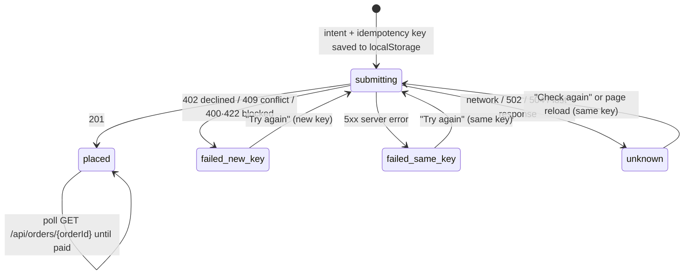

# MedEx Senior Frontend Assessment: Implementation

This repository contains all three take-home tasks, implemented in one React + TypeScript application with a local mock API:

| Task | Route | Brief |
|---|---|---|
| 1. Service Explorer with live faceted filters | `/explorer` | [task1_service_explorer.pdf](assessment-briefs/task1_service_explorer.pdf) |
| 2. Multi-provider cart and split checkout | `/cart` | [task2_cart_split_checkout.pdf](assessment-briefs/task2_cart_split_checkout.pdf) |
| 3. Appointment booking across time zones | `/booking` | [task3_booking_time_zones.pdf](assessment-briefs/task3_booking_time_zones.pdf) |

**Run:** `npm install && npm run dev` (Node ≥ 20). This starts the mock API on `:4010` plus the Vite dev server. Every API response takes a fixed 1.5 s so the loading states are visible, and each feature page has a **Refresh** button above its list that re-requests the data with the current filters. Scripts and project layout: [§10](#10-project-structure-and-scripts).

---

## 1. Project overview

MedEx is a healthcare marketplace across Thailand, Nepal and India. The briefs test UI and UX against messy, production-shaped data: three currencies with no exchange rates, prices sent as decimal strings, duplicate category slugs, empty cart products, six different spellings of a time zone, and requests that fail halfway.

What's delivered:
- **Explorer:** browse 3,200 services grouped by provider, with live facet counts and a URL-driven state.
- **Cart:** grouped per service type and currency; optimistic, race-free quantity changes; a guest-cart merge; per-group checkout that is safe against double charges, partial failure and page reloads.
- **Booking:** a 90-day calendar and slot picker on two clocks (provider and customer), with group bookings, conflict recovery and rescheduling.

**Stack:**
- React 19 and TypeScript (strict), Vite 8, React Router 7, TanStack Query 5, Zod 4.
- Tailwind CSS 4 with shadcn/ui (Radix), Lucide icons.
- Vitest with Testing Library.
- Mock API: JSON Server 0.17.4 + Express, with `date-fns-tz`.

Vite was kept because the repository was already a Vite scaffold and the app is purely client-side against a separate API. Next.js was preferred in the brief but not required.

## 2. Implementation overview

- **Feature modules.** Each task lives in [`src/features/<feature>/`](src/features) with the same four layers:
  - `api/`: one typed function per endpoint, with Zod validation.
  - `domain/`: pure business rules, with no React and no `fetch`.
  - `hooks/`: orchestration and side effects.
  - `components/`: UI only.

  Shared code is [`src/shared/`](src/shared) (HTTP client, money, app-level UI) and [`src/components/ui/`](src/components/ui) (shadcn primitives). The features never import each other.
- **One HTTP boundary.** [`apiRequest`](src/shared/api/client.ts):
  - turns every failure into a typed `ApiError` (`http` / `network` / `aborted` / `parse`)
  - exposes `isOutcomeUnknown`, which both write flows use to tell "failed" apart from "may have happened"
  - is reached through a Vite proxy at `/api`, so the bundle contains no API URL and needs no CORS
- **Data handling.** Raw API records are validated once at the edge, then mapped to view models:
  - The explorer is validated record by record ([`parseCollection`](src/features/service-explorer/api/schemas.ts)) and indexed once ([`buildExplorerIndex`](src/features/service-explorer/domain/normalize.ts)): visibility rules, the price formula, joined provider data, precomputed search text. Bad records become visible "data issues" instead of crashes.
  - The cart view is rebuilt from the server cart plus optimistic overrides ([`buildCartView`](src/features/cart-checkout/domain/cart.ts)).
- **State lives where it belongs:**

  | State | Where |
  |---|---|
  | Server data | TanStack Query |
  | Filters and booking selections | The URL |
  | Checkout intents (must survive a crash mid-request) | A small module store written to `localStorage` before the POST, read with `useSyncExternalStore` |
  | Everything else | Local component state |

  There is no global store library.
- **Mock API** ([`mock-api/server.cjs`](mock-api/server.cjs)): every `/api` response waits a fixed 1.5 s. JSON Server serves the Task 1 collections (read-only). Hand-written routes cover what JSON Server can't: idempotent checkout, merge rules, slot generation and 409s. The rules are plain, tested functions in [`lib/cart.cjs`](mock-api/lib/cart.cjs) and [`lib/booking.cjs`](mock-api/lib/booking.cjs). State is in memory, and dates are computed from each provider's "today" at start-up, so they never go stale.

## 3. Architecture


## 4. Key features and implementation

| Feature | How it works | Source |
|---|---|---|
| Final price | The brief's formula on parsed decimals, never rounded mid-calculation. Returns `fixed` / `free` / `from` (wellness: lowest option, labelled) / `invalid` (discount > price → "Price unavailable") | [`domain/pricing.ts`](src/features/service-explorer/domain/pricing.ts) |
| Visibility and data issues | Service active, provider `active`, category active. Unknown currency or a missing category hides the record and reports it in "About this data" | [`domain/normalize.ts`](src/features/service-explorer/domain/normalize.ts), [`ResultStates.tsx`](src/features/service-explorer/components/ResultStates.tsx) |
| Live facet counts | One pass over all services, counting the active facets that reject each one: 0 → a result counted in every facet, 1 → counted only in the facet that rejected it. Checked against brute force on 300 random combinations | [`domain/facets.ts`](src/features/service-explorer/domain/facets.ts) |
| URL as source of truth | `parseFilters` (never throws) → `canonicalizeFilters` (drops unknown ids) → `serializeFilters`. Filter changes push history; typing replaces it | [`domain/urlState.ts`](src/features/service-explorer/domain/urlState.ts), [`useExplorerUrlState.ts`](src/features/service-explorer/hooks/useExplorerUrlState.ts) |
| Grouping, sorting, pages | By provider, up to 3 previews per card plus "View all N". Relevance = title-match score, then a Bayesian rating. Price sorts are sectioned by currency | [`domain/grouping.ts`](src/features/service-explorer/domain/grouping.ts), [`ProviderCard.tsx`](src/features/service-explorer/components/ProviderCard.tsx) |
| Mobile drawer | Edits a draft and re-runs the engine for a live "Show N results" | [`FilterDrawer.tsx`](src/features/service-explorer/components/FilterDrawer.tsx) |
| Cart totals | `product.price` is the final unit price. Subtotals are kept per currency, with no grand total. Wellness without a duration is unpriced and blocks its group; an empty product is unavailable and removable | [`domain/cart.ts`](src/features/cart-checkout/domain/cart.ts) |
| Optimistic quantities | A per-line serial queue (`confirmed` / `desired` / `inFlight`): one request in flight per line, taps merged into the latest value, rollback to the confirmed quantity with a reason | [`domain/quantityQueue.ts`](src/features/cart-checkout/domain/quantityQueue.ts), [`useQuantityQueue.ts`](src/features/cart-checkout/hooks/useQuantityQueue.ts) |
| Split checkout | One order per group. The intent and idempotency key are saved before the POST. A reload replays interrupted attempts with the same key. Card orders are polled until paid or failed | [`useCheckout.ts`](src/features/cart-checkout/hooks/useCheckout.ts), [`domain/checkout.ts`](src/features/cart-checkout/domain/checkout.ts), [`lib/cart.cjs`](mock-api/lib/cart.cjs) |
| Guest cart merge | Server-side rules (combine and cap at 20, add, skip unknown, wellness duration applied, kept or needs a choice). Idempotent per `mergeId`; every change is listed to the customer | [`useGuestCart.ts`](src/features/cart-checkout/hooks/useGuestCart.ts), [`domain/merge.ts`](src/features/cart-checkout/domain/merge.ts) |
| Time zones | Free text → trim → alias → IANA → Windows name → offset → country fallback, with a note shown to customers. The server returns UTC instants; the client formats both clocks with `Intl` | [`lib/booking.cjs`](mock-api/lib/booking.cjs) `normalizeTimezone`, [`domain/time.ts`](src/features/appointment-booking/domain/time.ts) |
| Slots and calendar | Cadence = duration + buffer; a slot must lie inside both consultation and opening hours; past slots are judged by the provider's clock. N people need N consecutive free slots. 90-day calendar with a reason for each unavailable day | [`lib/booking.cjs`](mock-api/lib/booking.cjs) `buildDay` / `buildCalendar`, [`CalendarGrid.tsx`](src/features/appointment-booking/components/CalendarGrid.tsx), [`SlotPicker.tsx`](src/features/appointment-booking/components/SlotPicker.tsx) |
| Conflicts and unknown outcomes | 409 → selections kept (in the URL) plus the 3 nearest free times and the next available day. Network, 502 or 504 → only "Check again" with the same key | [`domain/submit.ts`](src/features/appointment-booking/domain/submit.ts), [`domain/alternatives.ts`](src/features/appointment-booking/domain/alternatives.ts), [`useBookingSubmit.ts`](src/features/appointment-booking/hooks/useBookingSubmit.ts) |
| Loading and Refresh | Fixed 1.5 s mock response delay. [`RefreshButton`](src/shared/ui/RefreshButton.tsx) above each feature page's list calls `refetchQueries` for that page's query key; the URL filters and booking selections are re-applied to the fresh data | [`server.cjs`](mock-api/server.cjs), [`RefreshButton.tsx`](src/shared/ui/RefreshButton.tsx), [`ResultsToolbar.tsx`](src/features/service-explorer/components/ResultsToolbar.tsx) |

### 4.1 Checkout state machine

Each cart group is checked out on its own, as a separate order. The state is kept in [`useCheckout.ts`](src/features/cart-checkout/hooks/useCheckout.ts) and the transitions are pure functions in [`domain/checkout.ts`](src/features/cart-checkout/domain/checkout.ts) (`classifyCheckoutError`, `shouldReuseKey`, `reconcilePlan`).



- **The intent is written before the request leaves.** If the tab closes mid-request, the next visit replays the `submitting` and `unknown` records with their saved key (`reconcile`).
- **The server makes retries safe.** The same key with the same payload returns the original order, and the same key with a different payload is rejected with 409. So neither a replay nor a retry can create a second order.
- **Keys are reused deliberately.** A new key is used only when no order can exist (402, 409, 422). "Check out all" runs the ready groups one after another, and one failure doesn't stop the others or touch orders already placed.
- **Card orders settle later.** They are polled every 1.5 s (TanStack Query `refetchInterval`) until the mock marks them paid, about 2.5 s after creation. Pay-at-clinic orders stay "Booked — pay at the clinic".

## 5. Important technical decisions

- **Rules in pure functions, tested where they live.** 119 of the 149 tests target `domain/` or `mock-api/lib/` functions. Components stay thin, so a teammate can change a rule in one file.
- **Load once and compute in the browser (Task 1).** The brief needs live counts over all 3,200 services, so the three collections load once and are indexed (prices and search text are precomputed). Each filter change is then one O(services × active facets) pass, memoised in `ExplorerPage`. Typing goes through `useDeferredValue`, and the URL is written 300 ms after typing stops.
- **Validate at the boundary, tolerate per record.** The explorer schemas fall back field by field, and only records missing an identity field are dropped and reported. Booking schemas are strict, because the UI trusts those values. A cart `product` is validated per line, so `{}` becomes "unavailable" instead of an error.
- **Currency is part of every amount** (`Money = { amount, currency }`). The price filter only exists together with a chosen currency (`cur`); without one, price sorts are sectioned by currency.
- **Zero-count facet options are disabled, not hidden.** The layout stays stable and customers can see the option exists, and a selected option is never disabled, so it can always be undone.
- **Double-charge prevention.** The server is idempotent per key and payload. The client reuses a key only when an order might exist (unknown outcome or 5xx) and uses a new key after 402, 409 or 422. The intent is on disk before the request leaves.
- **Availability is computed on the server, displayed by the client.** One implementation of the slot rules means the picker and the booking check can't disagree. The client never does offset arithmetic.
- **Tests run the real mock.** [`src/test/mockServer.ts`](src/test/mockServer.ts) starts `createApp({ now })` on a random port with a frozen, advanceable clock, so there's no hand-written fake server to drift out of sync.
- **Reusable UI.** Feature code builds on shadcn primitives and a few app-level components (`ErrorState`, `EmptyState`, `OfflineBanner`, `NativeSelect`). Selects and slot radios are native controls on purpose, for keyboard and screen-reader reliability.

**Time-zone values in the fixture and how each is resolved:**

| Provider | Raw value | Resolved | Rule |
|---|---|---|---|
| 48 Riverside International Hospital (TH) | `"Asia/Bangkok"` | Asia/Bangkok | IANA |
| 46 Himal Neo Clinic (NP) | `" UTC+05:45"` | Asia/Kathmandu | offset (matches country) |
| 112 Annapurna Diagnostics (NP) | `"Nepal Standard Time"` | Asia/Kathmandu | Windows name |
| 118 Pashupati Medical Centre (NP) | `"(GMT+5:45)"` | Asia/Kathmandu | offset |
| 121 Lumbini Polyclinic (NP) | `"Asia/Katmandu "` | Asia/Kathmandu | legacy alias (trimmed) |
| 131 Aravali Hospital (IN) | `""` | Asia/Kolkata | country fallback, with an explanation shown to the customer |

## 6. Assessment requirements coverage

Status is based on the source code. "Partial" means part of the requirement has evidence and part doesn't.

**Task 1: Service Explorer**

| Requirement | Status | Evidence |
|---|---|---|
| Grouped by provider, rating or "No ratings yet", ≤ 3 services, "View all N" (filtered count) | Implemented | [`ProviderCard.tsx`](src/features/service-explorer/components/ProviderCard.tsx), [`grouping.ts`](src/features/service-explorer/domain/grouping.ts) |
| Filters: type, category → subcategory tree, searchable provider, city or country, price range, home test | Implemented | [`FilterPanel.tsx`](src/features/service-explorer/components/FilterPanel.tsx), [`facets.ts`](src/features/service-explorer/domain/facets.ts) |
| Free-text search over title, provider and category | Implemented | `searchText` in [`normalize.ts`](src/features/service-explorer/domain/normalize.ts) |
| Live facet counts; zero options disabled (justified in §5) | Implemented | [`facets.ts`](src/features/service-explorer/domain/facets.ts), [`facets.test.ts`](src/features/service-explorer/domain/facets.test.ts) |
| Final price, struck original, honest wellness price | Implemented | [`pricing.ts`](src/features/service-explorer/domain/pricing.ts), [`PriceTag.tsx`](src/features/service-explorer/components/PriceTag.tsx) |
| Price range never mixes currencies | Implemented | `price` predicate in [`facets.ts`](src/features/service-explorer/domain/facets.ts), [`PriceRange.tsx`](src/features/service-explorer/components/PriceRange.tsx) |
| Sorting: relevance (defined), price both ways, rating | Implemented | [`grouping.ts`](src/features/service-explorer/domain/grouping.ts) |
| URL is the source of truth (reload, share, back/forward) | Implemented | [`urlState.ts`](src/features/service-explorer/domain/urlState.ts), [`ExplorerPage.test.tsx`](src/features/service-explorer/components/ExplorerPage.test.tsx) |
| Mobile drawer with pending "Show N results" | Implemented | [`FilterDrawer.tsx`](src/features/service-explorer/components/FilterDrawer.tsx) |
| Performance: ~100 ms per filter change, typing never blocks, no layout shift | **Partial** | The engine is measured in jsdom only (see §7). Non-blocking input relies on `useDeferredValue`, and the skeletons have the same footprint as the cards. No in-browser profile or layout-shift measurement was recorded |
| States: skeletons, empty with a way out, retry | Implemented | [`ResultStates.tsx`](src/features/service-explorer/components/ResultStates.tsx), [`ErrorState.tsx`](src/shared/ui/ErrorState.tsx) |
| Mock API able to fail on demand | **Not implemented** (removed, see §8) | The error state and Retry exist and are tested, but a reviewer can't trigger them |
| Keyboard use; result-count changes announced | Implemented (not tested with a screen reader) | `role="status"` in [`ResultsToolbar.tsx`](src/features/service-explorer/components/ResultsToolbar.tsx) |
| Duplicate `ultrasound` slugs | Implemented | Ids everywhere; the type is shown next to the title |

**Task 2: Cart and split checkout**

| Requirement | Status | Evidence |
|---|---|---|
| Mock endpoints, idempotent `POST /checkout` | Implemented (under `/api`) | [`server.cjs`](mock-api/server.cjs), [`cart.cjs`](mock-api/lib/cart.cjs), endpoint list in [`mock-api/README.md`](mock-api/README.md) |
| Latency and failure injection on demand for a specific call | **Not implemented** (removed, see §8): fixed 1.5 s delay only | Partial-failure, decline and lost-response paths are covered by tests ([`useCheckout.test.ts`](src/features/cart-checkout/hooks/useCheckout.test.ts)) but can't be shown in the UI |
| Grouped by type, per-currency subtotals, no cross-currency total, helpful summary | Implemented | [`cart.ts`](src/features/cart-checkout/domain/cart.ts), [`CartSummary.tsx`](src/features/cart-checkout/components/CartSummary.tsx) |
| Optimistic quantities, rollback with reason, 5 quick taps don't race | Implemented | [`quantityQueue.ts`](src/features/cart-checkout/domain/quantityQueue.ts) + tests |
| Wellness needs a duration, never counted as 0 | Implemented | `needs-duration` in [`cart.ts`](src/features/cart-checkout/domain/cart.ts) |
| Unavailable items marked, not checkoutable, easy to remove | Implemented | [`CartLineItem.tsx`](src/features/cart-checkout/components/CartLineItem.tsx) |
| Split checkout per group or all at once, card or pay at clinic | Implemented | [`CartGroupCard.tsx`](src/features/cart-checkout/components/CartGroupCard.tsx), [`useCheckout.ts`](src/features/cart-checkout/hooks/useCheckout.ts) |
| Partial failure: nothing lost or doubled, clear outcomes, retry only what failed | Implemented | [`checkout.ts`](src/features/cart-checkout/domain/checkout.ts), [`useCheckout.test.ts`](src/features/cart-checkout/hooks/useCheckout.test.ts) |
| Reload safety: show the true state after a refresh | Implemented | `reconcile()` / `reconcilePlan` |
| Guest merge with every change explained | Implemented | [`cart.cjs`](mock-api/lib/cart.cjs) `mergeGuestCart`, [`GuestMergeNotice.tsx`](src/features/cart-checkout/components/GuestMergeNotice.tsx) |
| Loading, empty and offline states; keyboard; focus on remove and checkout changes | Implemented | [`CartPage.tsx`](src/features/cart-checkout/components/CartPage.tsx), [`CheckoutStatus.tsx`](src/features/cart-checkout/components/CheckoutStatus.tsx) |
| Slow-network state | **Partial** | Per-line "Saving…" and "Placing order…" exist, but the cart has no "still loading" hint like the explorer and booking pages have |
| Checkout state machine documented | Implemented | [§4.1](#41-checkout-state-machine) |

**Task 3: Booking across time zones**

| Requirement | Status | Evidence |
|---|---|---|
| Mock endpoints | Implemented (under `/api`; slots return `state: 'booked'` rather than an `isBooked` boolean) | [`server.cjs`](mock-api/server.cjs), [`booking.cjs`](mock-api/lib/booking.cjs) |
| 409, latency and failure on demand | **Partial** (see §8) | A real 409 happens when the slot was taken (for example, two tabs); latency is a fixed 1.5 s; 500 and network failures can't be injected |
| Every time-zone value handled; country fallback documented | Implemented | Table in §5, [`booking.test.mjs`](mock-api/lib/booking.test.mjs) |
| `dayOffset` from the provider's today, turned into dates at start-up | Implemented | `createBookingState` |
| 90-day calendar; unavailable days say why | Implemented | `buildCalendar`, [`CalendarGrid.tsx`](src/features/appointment-booking/components/CalendarGrid.tsx) |
| Two clocks, provider time primary, day-shift marker | Implemented | [`time.ts`](src/features/appointment-booking/domain/time.ts), [`TimezoneBar.tsx`](src/features/appointment-booking/components/TimezoneBar.tsx) |
| Slots grouped by morning, afternoon and evening; booked visible but disabled; past by the provider's clock | Implemented | [`SlotPicker.tsx`](src/features/appointment-booking/components/SlotPicker.tsx), `buildDay` |
| Specialist narrows slots; only the overlap with opening hours, explained | Implemented | `WindowNote` in [`BookingPage.tsx`](src/features/appointment-booking/components/BookingPage.tsx) |
| Groups up to 4 need N consecutive free slots | Implemented | `buildDay` + tests |
| 409 keeps everything, explains, offers the closest alternatives | Implemented | [`alternatives.ts`](src/features/appointment-booking/domain/alternatives.ts), [`BookingSummary.tsx`](src/features/appointment-booking/components/BookingSummary.tsx) |
| Reschedule with an unmistakable old → new change | Implemented | Reschedule route, [`BookingSummary.tsx`](src/features/appointment-booking/components/BookingSummary.tsx) |
| Skeletons; no-slot days and specialists without availability explained, with a way forward; retry keeps selections | Implemented | [`BookingPage.tsx`](src/features/appointment-booking/components/BookingPage.tsx) |
| Slow and offline visible; never confirm with an unknown result | Implemented | `useDelayedFlag`, `OfflineBanner`, `unknown` state |
| Keyboard-navigable calendar and slot grid; screen-reader announcements | Implemented (not tested with a screen reader) | WAI-ARIA grid in [`CalendarGrid.tsx`](src/features/appointment-booking/components/CalendarGrid.tsx), native radios |
| Unit tests for time-zone and slot logic, including awkward cases | Implemented | [`booking.test.mjs`](mock-api/lib/booking.test.mjs) (17), [`time.test.ts`](src/features/appointment-booking/domain/time.test.ts) |

**Submission items from the briefs**

| Item | Status |
|---|---|
| One-command run, decisions and trade-offs, left-out items, AI usage | Covered in this README |
| Git repository with a commit history | **Not done**: the repository has no commits yet |
| Deployed link or screen recording (optional) | Not provided |

## 7. Testing and verification

These checks were run on 27 October 2026, against the current code:

| Check | Result |
|---|---|
| `npm run typecheck` (`tsc -b`, including tests) | Pass |
| `npm run lint` (oxlint) | Pass (exit 0) |
| `npm test` (Vitest) | **20 files, 149 tests, all passing** |
| `npm run build` | Pass |
| `npm run check:api` against a freshly started mock | 7 / 7 pass; each `/api` call ≈ 1.5 s |
| Browser check (Chromium) against the real mock | Skeleton visible during the delay; Refresh on explorer, cart, providers and booking re-requests the page's API and keeps the URL filters |
| Facet engine timing, 4 scenarios × 20 runs over the real fixture (jsdom) | Median **0.34 ms**, p95 **1.25 ms** (the test asserts p95 < 50 ms) |

**Approach:**
- Domain and mock rules are unit-tested with the real fixtures.
- Page tests run against the real mock server with a frozen clock. The mock never fails, so tests simulate failures in the stubbed `fetch` (`server.failNext`), and the booking 409 test uses a real conflict.

**Edge cases covered by tests:**
- the brief's pricing example, without rounding
- facet counts against a brute-force reference
- duplicate slugs and inactive categories
- currencies never summed
- five rapid taps
- intent saved before the request
- lost response → same key → no duplicate order
- reload reconciliation, and 500 vs 402 key reuse
- all six time-zone values
- the provider-local "today"
- buffers breaking consecutive runs
- late-evening day shift and daylight saving
- 409 keeps the selections
- reschedule not blocked by its own slot

**Where the 149 tests sit:** 119 are rules tests: explorer pricing, facets, grouping and URL state; cart, checkout and the quantity queue; booking time and calendar; and the mock API's cart and booking rules in `mock-api/lib/*.test.mjs`. 20 are page tests against the real mock (explorer, cart, booking). The rest are hooks (`useCheckout`, `useQuantityQueue`), `RefreshButton` and an architecture rule that app code never imports `data/*.json`.

**Not verified:**
- no in-browser performance profile
- no screen-reader or automated accessibility (axe) testing
- no browser end-to-end tests
- no coverage percentage (no coverage tool is installed)

## 8. Deliberately left out and known limitations

- **Booking keys aren't persisted.** The booking idempotency key is kept in memory only. A reload during an "unknown" booking outcome loses it, whereas checkout persists its intent. With more time I'd store it like the checkout intent.
- **Lost quantity updates.** After a lost quantity update (502), the line rolls back to the last confirmed value even though the server may have applied the change. The next cart refresh shows the true value.
- **No failure simulation.** Late in the project, the mock's on-demand failures and the DevPanel were removed in favour of a fixed 1.5 s delay. The app still handles errors, 409s and unknown outcomes (and tests cover them), but reviewers can't trigger them. This no longer meets the briefs' "fail on demand" requirement.
- **Late payment failure.** The client shows "Payment failed" for a card payment that fails after the order is created, with no in-app way to pay again. The mock no longer produces this status.
- **No catalogue screen.** There's no "add to cart" page (not in the brief); the cart starts from the fixture. There's also no real login: the guest merge is triggered by a button.
- **Calendar scope.** The calendar shows availability for the chosen specialist only, and alternatives are same-day times plus the next available day.
- **Duplicate error id.** `ErrorState` uses a fixed DOM id, so two error panels on the booking page at once would duplicate it.
- **Mock limits.** The mock API is in memory and not production infrastructure. Nothing is deployed.

## 9. Use of AI tools

The implementation was built with **Claude Code**, driven by the phased prompts in [`prompts/`](prompts) (audit → architecture → Task 1 → Task 2 → Task 3 → review → UI redesign → simplification). Project rules are in [`CLAUDE.md`](CLAUDE.md), and Claude Code skills are in [`.claude/skills/`](.claude/skills). This README was also written with Claude Code from the source and checked against it. More detailed study notes were generated for my own reference and are kept out of the repository.

## 10. Project structure and scripts

```text
src/
  app/                      App.tsx (QueryClient + lazy routes), Layout, HomePage, NotFoundPage
  features/
    service-explorer/       api/ · domain/ (pricing, normalize, facets, grouping, urlState) · hooks/ · components/
    cart-checkout/          api/ · domain/ (cart, checkout, quantityQueue, merge, storage) · hooks/ · components/
    appointment-booking/    api/ · domain/ (time, calendar, alternatives, submit) · hooks/ · components/
  shared/                   api/client.ts (apiRequest, ApiError) · lib/ (money, hooks) · ui/ (ErrorState, EmptyState,
                            OfflineBanner, NativeSelect, RefreshButton, …)
  components/ui/            shadcn/ui primitives
  test/                     mockServer.ts (real mock on a random port, frozen clock, failNext), fixture helpers
mock-api/                   server.cjs (routes, 1.5 s delay) · lib/cart.cjs · lib/booking.cjs (+ tests) · README.md
data/                       the three supplied JSON fixtures (served only through the mock API)
assessment-briefs/          the three task PDFs
scripts/                    dev.mjs (mock API + Vite together) · check-api.mjs (smoke check)
```

| Script | What it does |
|---|---|
| `npm run dev` | Mock API on `:4010` and Vite together (Vite proxies `/api` and `/health` to `MOCK_API_URL`) |
| `npm test` | Vitest (jsdom), all 149 tests |
| `npm run typecheck` / `npm run lint` / `npm run build` | `tsc -b` / oxlint / `tsc -b && vite build` |
| `npm run check:api` | Smoke-checks a running mock API |

The API lives under `/api` in [`mock-api/server.cjs`](mock-api/server.cjs), and every endpoint is listed in [`mock-api/README.md`](mock-api/README.md). In outline:
- **Task 1:** three read-only collections.
- **Task 2:** cart, line updates, guest merge, idempotent checkout and order status.
- **Task 3:** providers, a 90-day calendar, slots, and create or reschedule booking, with a 409 `slot-taken` plus alternatives.
