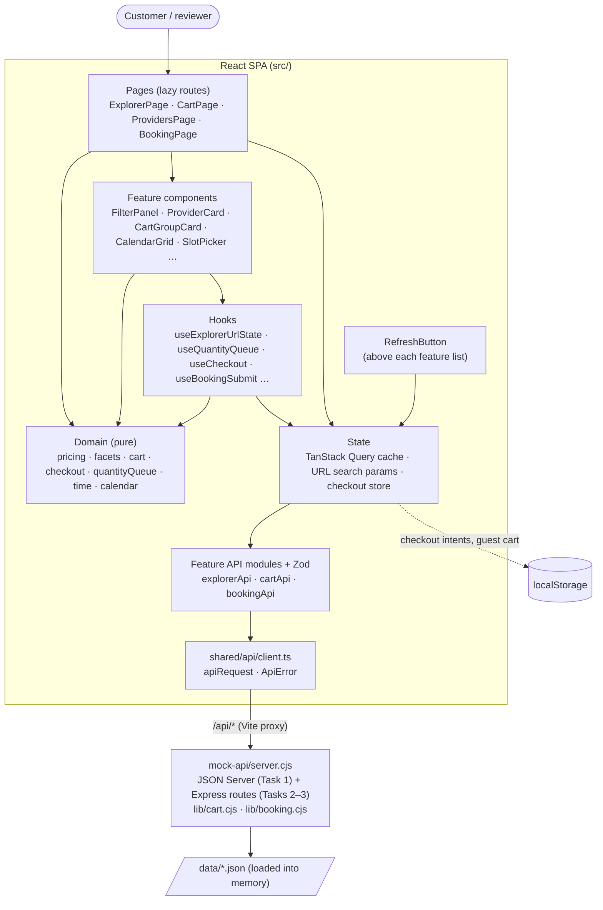
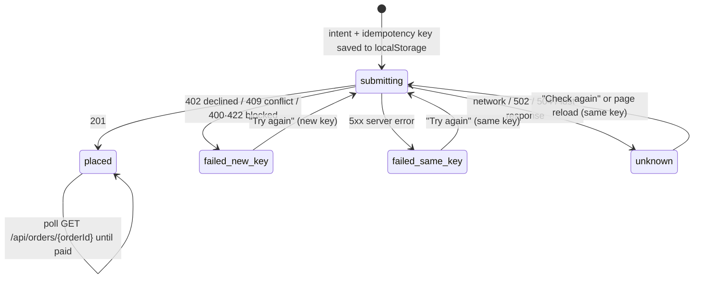

# MedEx Senior Frontend Assessment: Implementation

This repository contains all three take-home tasks, implemented in one React + TypeScript application with a local mock API:

| Task | Route | Brief |
|---|---|---|
| 1. Service Explorer with live faceted filters | `/explorer` | [task1_service_explorer.pdf](assessment-briefs/task1_service_explorer.pdf) |
| 2. Multi-provider cart and split checkout | `/cart` | [task2_cart_split_checkout.pdf](assessment-briefs/task2_cart_split_checkout.pdf) |
| 3. Appointment booking across time zones | `/booking` | [task3_booking_time_zones.pdf](assessment-briefs/task3_booking_time_zones.pdf) |

**Run:** `npm install && npm run dev` (Node ≥ 20). This starts the mock API on `:4010` plus the Vite dev server. Every API response takes a fixed 1.5 s so the loading states are visible, and each feature page has a **Refresh** button above its list that re-requests the data with the current filters. To see slow, failing, conflicting or lost requests, open any page with a `?mock=` rule ([§4.2](#42-simulating-slow-and-failing-calls)). Scripts and project layout: [§10](#10-project-structure-and-scripts).

---

## 1. Project overview

MedEx is a healthcare marketplace across Thailand, Nepal and India. The briefs test UI and UX against messy, production-shaped data: three currencies with no exchange rates, prices sent as decimal strings, duplicate category slugs, empty cart products, six different spellings of a time zone, and requests that fail halfway.

What's delivered:
- **Explorer:** browse 3,200 services grouped by provider, with live facet counts and a URL-driven state.
- **Cart:** grouped per service type and currency; optimistic, race-free quantity changes; a guest-cart merge; per-group checkout that is safe against double charges, partial failure and page reloads.
- **Booking:** a 90-day calendar and slot picker on two clocks (provider and customer), with group bookings, conflict recovery and rescheduling.

**Stack:**
- React 19 and TypeScript (strict), Vite 8, React Router 7, TanStack Query 5, Zod 4.
- Tailwind CSS 4 with shadcn/ui (Radix), Lucide icons.
- Vitest with Testing Library.
- Mock API: JSON Server 0.17.4 + Express, with `date-fns-tz`.

Vite was kept because the repository was already a Vite scaffold and the app is purely client-side against a separate API. Next.js was preferred in the brief but not required.

## 2. Implementation overview

- **Feature modules.** Each task lives in [`src/features/<feature>/`](src/features) with the same four layers:
  - `api/`: one typed function per endpoint, with Zod validation.
  - `domain/`: pure business rules, with no React and no `fetch`.
  - `hooks/`: orchestration and side effects.
  - `components/`: UI only.

  Shared code is [`src/shared/`](src/shared) (HTTP client, money, app-level UI) and [`src/components/ui/`](src/components/ui) (shadcn primitives). The features never import each other.
- **One HTTP boundary.** [`apiRequest`](src/shared/api/client.ts):
  - turns every failure into a typed `ApiError` (`http` / `network` / `aborted` / `parse`)
  - exposes `isOutcomeUnknown`, which both write flows use to tell "failed" apart from "may have happened"
  - is reached through a Vite proxy at `/api`, so the bundle contains no API URL and needs no CORS
- **Data handling.** Raw API records are validated once at the edge, then mapped to view models:
  - The explorer is validated record by record ([`parseCollection`](src/features/service-explorer/api/schemas.ts)) and indexed once ([`buildExplorerIndex`](src/features/service-explorer/domain/normalize.ts)): visibility rules, the price formula, joined provider data, precomputed search text. Bad records become visible "data issues" instead of crashes.
  - The cart view is rebuilt from the server cart plus optimistic overrides ([`buildCartView`](src/features/cart-checkout/domain/cart.ts)).
- **State lives where it belongs:**

  | State | Where |
  |---|---|
  | Server data | TanStack Query |
  | Filters and booking selections | The URL |
  | Checkout intents (must survive a crash mid-request) | A small module store written to `localStorage` before the POST, read with `useSyncExternalStore` |
  | Everything else | Local component state |

  There is no global store library.
- **Mock API** ([`mock-api/server.cjs`](mock-api/server.cjs)): every `/api` response waits a fixed 1.5 s. Failures and extra latency are opt-in per request (the `x-mock-fault` / `x-mock-delay` headers, sent only for `?mock=` rules). JSON Server serves the Task 1 collections (read-only). Hand-written routes cover what JSON Server can't: idempotent checkout, merge rules, slot generation and 409s. The rules are plain, tested functions in [`lib/cart.cjs`](mock-api/lib/cart.cjs) and [`lib/booking.cjs`](mock-api/lib/booking.cjs). State is in memory. Fixture day offsets become dates at start-up, and the 90-day window follows each provider's live clock, so it rolls over at the provider's midnight.

## 3. Architecture



## 4. Key features and implementation

| Feature | How it works | Source |
|---|---|---|
| Final price | The brief's formula on parsed decimals, never rounded mid-calculation. Returns `fixed` / `free` / `from` (wellness: lowest option, labelled) / `invalid` (discount > price → "Price unavailable") | [`domain/pricing.ts`](src/features/service-explorer/domain/pricing.ts) |
| Visibility and data issues | Service active, provider `active`, category active. Unknown currency or a missing category hides the record and reports it in "About this data" | [`domain/normalize.ts`](src/features/service-explorer/domain/normalize.ts), [`ResultStates.tsx`](src/features/service-explorer/components/ResultStates.tsx) |
| Live facet counts | One pass over all services, counting the active facets that reject each one: 0 → a result counted in every facet, 1 → counted only in the facet that rejected it. Checked against brute force on 300 random combinations | [`domain/facets.ts`](src/features/service-explorer/domain/facets.ts) |
| URL as source of truth | `parseFilters` (never throws) → `canonicalizeFilters` (drops unknown ids) → `serializeFilters`. Filter changes push history; typing replaces it | [`domain/urlState.ts`](src/features/service-explorer/domain/urlState.ts), [`useExplorerUrlState.ts`](src/features/service-explorer/hooks/useExplorerUrlState.ts) |
| Grouping, sorting, pages | By provider, up to 3 previews per card plus "View all N". Relevance = title-match score, then a Bayesian rating. Price sorts are sectioned by currency | [`domain/grouping.ts`](src/features/service-explorer/domain/grouping.ts), [`ProviderCard.tsx`](src/features/service-explorer/components/ProviderCard.tsx) |
| Mobile drawer | Edits a draft and re-runs the engine for a live "Show N results" | [`FilterDrawer.tsx`](src/features/service-explorer/components/FilterDrawer.tsx) |
| Cart totals | `product.price` is the final unit price. Subtotals are kept per currency, with no grand total. Wellness without a duration is unpriced and blocks its group; an empty product is unavailable and removable | [`domain/cart.ts`](src/features/cart-checkout/domain/cart.ts) |
| Optimistic quantities | A per-line serial queue (`confirmed` / `desired` / `inFlight`): one request in flight per line, taps merged into the latest value, rollback to the confirmed quantity with a reason | [`domain/quantityQueue.ts`](src/features/cart-checkout/domain/quantityQueue.ts), [`useQuantityQueue.ts`](src/features/cart-checkout/hooks/useQuantityQueue.ts) |
| Split checkout | One order per group. The intent and idempotency key are saved before the POST. A reload replays interrupted attempts with the same key. Card orders are polled until paid or failed. The summary also tells the whole story in one sentence (`summarizeCheckout`: "1 of 2 orders placed. Wellness was not ordered. Your other orders are not affected…") | [`useCheckout.ts`](src/features/cart-checkout/hooks/useCheckout.ts), [`domain/checkout.ts`](src/features/cart-checkout/domain/checkout.ts), [`lib/cart.cjs`](mock-api/lib/cart.cjs) |
| Guest cart merge | Server-side rules (combine and cap at 20, add, skip unknown, wellness duration applied, kept or needs a choice). Idempotent per `mergeId`; every change is listed to the customer | [`useGuestCart.ts`](src/features/cart-checkout/hooks/useGuestCart.ts), [`domain/merge.ts`](src/features/cart-checkout/domain/merge.ts) |
| Time zones | Free text → trim → alias → IANA → Windows name → offset → country fallback, with a note shown to customers. The server returns UTC instants; the client formats both clocks with `Intl` | [`lib/booking.cjs`](mock-api/lib/booking.cjs) `normalizeTimezone`, [`domain/time.ts`](src/features/appointment-booking/domain/time.ts) |
| Slots and calendar | Cadence = duration + buffer; a slot must lie inside both consultation and opening hours; past slots are judged by the provider's clock. N people need N consecutive free slots. 90-day calendar with a reason for each unavailable day | [`lib/booking.cjs`](mock-api/lib/booking.cjs) `buildDay` / `buildCalendar`, [`CalendarGrid.tsx`](src/features/appointment-booking/components/CalendarGrid.tsx), [`SlotPicker.tsx`](src/features/appointment-booking/components/SlotPicker.tsx) |
| Conflicts and unknown outcomes | 409 → selections kept (in the URL) plus the 3 nearest free times and the next available day. Network, 502 or 504 → only "Check again" with the same key. The attempt and key are saved before the request, so a reload mid-booking replays it with the same key instead of risking a second booking | [`domain/submit.ts`](src/features/appointment-booking/domain/submit.ts), [`domain/alternatives.ts`](src/features/appointment-booking/domain/alternatives.ts), [`useBookingSubmit.ts`](src/features/appointment-booking/hooks/useBookingSubmit.ts) |
| Failure flags | `?mock=<target>[#n]:<effect>` arms a one-shot fault for the nth matching request; a banner shows what's armed. The mock answers with the status, loses the reply after handling the request (`lost` → 504), adds 3 s (`slow`), or for a booking 409 really lets "someone else" take the time | [`mockFlags.ts`](src/shared/api/mockFlags.ts), [`MockFlagsBanner.tsx`](src/shared/ui/MockFlagsBanner.tsx), [`server.cjs`](mock-api/server.cjs), `takeSlot` in [`booking.cjs`](mock-api/lib/booking.cjs) |
| Loading and Refresh | Fixed 1.5 s mock response delay. [`RefreshButton`](src/shared/ui/RefreshButton.tsx) above each feature page's list calls `refetchQueries` for that page's query key; the URL filters and booking selections are re-applied to the fresh data | [`server.cjs`](mock-api/server.cjs), [`RefreshButton.tsx`](src/shared/ui/RefreshButton.tsx), [`ResultsToolbar.tsx`](src/features/service-explorer/components/ResultsToolbar.tsx) |

### 4.1 Checkout state machine

Each cart group is checked out on its own, as a separate order. The state is kept in [`useCheckout.ts`](src/features/cart-checkout/hooks/useCheckout.ts) and the transitions are pure functions in [`domain/checkout.ts`](src/features/cart-checkout/domain/checkout.ts) (`classifyCheckoutError`, `shouldReuseKey`, `reconcilePlan`).



- **The intent is written before the request leaves.** If the tab closes mid-request, the next visit replays the `submitting` and `unknown` records with their saved key (`reconcile`).
- **The server makes retries safe.** The same key with the same payload returns the original order, and the same key with a different payload is rejected with 409. So neither a replay nor a retry can create a second order.
- **Keys are reused deliberately.** A new key is used only when no order can exist (402, 409, 422). "Check out all" runs the ready groups one after another, and one failure doesn't stop the others or touch orders already placed.
- **Card orders settle later.** They are polled every 1.5 s (TanStack Query `refetchInterval`) until the mock marks them paid, about 2.5 s after creation. Pay-at-clinic orders stay "Booked — pay at the clinic".
- **Several orders, one story.** Each group card shows its own status, the summary lists placed orders with their payment ("Paid", "Booked — pay at the clinic"), and one sentence above it says what succeeded and what still needs the customer, without technical codes.

### 4.2 Simulating slow and failing calls

The mock never fails on its own. To see a failure state, open any page with `?mock=` followed by one or more comma-separated rules, `<target>[#n]:<effect>`:
- **target:** any part of `METHOD /path`, for example `checkout`, `cart/items`, `slots`, `calendar`, `bookings` or `explorer/services`
- **#n:** fail the nth matching request (default: the first)
- **effect:** an HTTP status from 400 to 599; `lost` (the server handles the request, then the reply is lost and the gateway answers 504); or `slow` (+3 s)

Each rule fires once. The rules are kept for the tab in `sessionStorage`, and `?mock=` is removed from the address bar, so a reload doesn't re-arm them. A banner lists the rules still armed, with **Turn off** (or use `?mock=off`).

| To see | Open |
|---|---|
| Explorer error and retry | `/explorer?mock=explorer/services:500` |
| Partial checkout failure: the second group fails, retry only it | `/cart?mock=checkout#2:500` |
| Card declined | `/cart?mock=checkout:402` |
| Lost reply → "Checking…" → same key, one order (also try reloading) | `/cart?mock=checkout:lost` |
| Rejected quantity change rolls back | `/cart?mock=cart/items:409` |
| Someone else took the slot (real 409 with alternatives) | `/booking/48?mock=bookings:409` |
| Slow slot grid, then an error with retry | `/booking/48?mock=slots:slow,slots#2:500` |

## 5. Important technical decisions

- **Rules in pure functions, tested where they live.** 125 of the 170 tests target `domain/` or `mock-api/lib/` functions. Components stay thin, so a teammate can change a rule in one file.
- **Load once and compute in the browser (Task 1).** The brief needs live counts over all 3,200 services, so the three collections load once and are indexed (prices and search text are precomputed). Each filter change is then one O(services × active facets) pass, memoised in `ExplorerPage`. Typing goes through `useDeferredValue`, and the URL is written 300 ms after typing stops ([`useSearchInput.ts`](src/features/service-explorer/hooks/useSearchInput.ts)): the box adopts URL changes from back/forward or chips, but not its own commit arriving late, so it never blanks or loses keystrokes. Results dim only if they lag more than 200 ms, so fast typing doesn't flicker.
- **Validate at the boundary, tolerate per record.** The explorer schemas fall back field by field, and only records missing an identity field are dropped and reported. Booking schemas are strict, because the UI trusts those values. A cart `product` is validated per line, so `{}` becomes "unavailable" instead of an error.
- **Currency is part of every amount** (`Money = { amount, currency }`). The price filter only exists together with a chosen currency (`cur`); without one, price sorts are sectioned by currency.
- **Zero-count facet options are disabled, not hidden.** The layout stays stable and customers can see the option exists, and a selected option is never disabled, so it can always be undone.
- **Double-charge prevention.** The server is idempotent per key and payload. The client reuses a key only when an order might exist (unknown outcome or 5xx) and uses a new key after 402, 409 or 422. The intent is on disk before the request leaves. Bookings follow the same rule.
- **Fault injection is opt-in and one-shot.** Failures are armed from the page URL and sent as request headers, so the normal app never fails, a reviewer can fail one specific call, and the retry that follows succeeds. A transport-level "network error" can't pass through the dev proxy, so a lost connection is simulated as `lost` (handled, then a 504). Real offline is shown by the browser's offline mode.
- **Availability is computed on the server, displayed by the client.** One implementation of the slot rules means the picker and the booking check can't disagree. The client never does offset arithmetic.
- **Tests run the real mock.** [`src/test/mockServer.ts`](src/test/mockServer.ts) starts `createApp({ now })` on a random port with a frozen, advanceable clock, so there's no hand-written fake server to drift out of sync.
- **Reusable UI.** Feature code builds on shadcn primitives and a few app-level components (`ErrorState`, `EmptyState`, `OfflineBanner`, `NativeSelect`). Selects and slot radios are native controls on purpose, for keyboard and screen-reader reliability.

**Time-zone values in the fixture and how each is resolved:**

| Provider | Raw value | Resolved | Rule |
|---|---|---|---|
| 48 Riverside International Hospital (TH) | `"Asia/Bangkok"` | Asia/Bangkok | IANA |
| 46 Himal Neo Clinic (NP) | `" UTC+05:45"` | Asia/Kathmandu | offset (matches country) |
| 112 Annapurna Diagnostics (NP) | `"Nepal Standard Time"` | Asia/Kathmandu | Windows name |
| 118 Pashupati Medical Centre (NP) | `"(GMT+5:45)"` | Asia/Kathmandu | offset |
| 121 Lumbini Polyclinic (NP) | `"Asia/Katmandu "` | Asia/Kathmandu | legacy alias (trimmed) |
| 131 Aravali Hospital (IN) | `""` | Asia/Kolkata | country fallback, with an explanation shown to the customer |

## 6. Assessment requirements coverage

Status is based on the source code. "Partial" means part of the requirement has evidence and part doesn't.

**Task 1: Service Explorer**

| Requirement | Status | Evidence |
|---|---|---|
| Grouped by provider, rating or "No ratings yet", ≤ 3 services, "View all N" (filtered count) | Implemented | [`ProviderCard.tsx`](src/features/service-explorer/components/ProviderCard.tsx), [`grouping.ts`](src/features/service-explorer/domain/grouping.ts) |
| Filters: type, category → subcategory tree, searchable provider, city or country, price range, home test | Implemented | [`FilterPanel.tsx`](src/features/service-explorer/components/FilterPanel.tsx), [`facets.ts`](src/features/service-explorer/domain/facets.ts) |
| Free-text search over title, provider and category | Implemented | `searchText` in [`normalize.ts`](src/features/service-explorer/domain/normalize.ts) |
| Live facet counts; zero options disabled (justified in §5) | Implemented | [`facets.ts`](src/features/service-explorer/domain/facets.ts), [`facets.test.ts`](src/features/service-explorer/domain/facets.test.ts) |
| Final price, struck original, honest wellness price | Implemented | [`pricing.ts`](src/features/service-explorer/domain/pricing.ts), [`PriceTag.tsx`](src/features/service-explorer/components/PriceTag.tsx) |
| Price range never mixes currencies | Implemented | `price` predicate in [`facets.ts`](src/features/service-explorer/domain/facets.ts), [`PriceRange.tsx`](src/features/service-explorer/components/PriceRange.tsx) |
| Sorting: relevance (defined), price both ways, rating | Implemented | [`grouping.ts`](src/features/service-explorer/domain/grouping.ts) |
| URL is the source of truth (reload, share, back/forward) | Implemented | [`urlState.ts`](src/features/service-explorer/domain/urlState.ts), [`ExplorerPage.test.tsx`](src/features/service-explorer/components/ExplorerPage.test.tsx) |
| Mobile drawer with pending "Show N results" | Implemented | [`FilterDrawer.tsx`](src/features/service-explorer/components/FilterDrawer.tsx) |
| Performance: ~100 ms per filter change, typing never blocks, no layout shift | **Partial** | The engine is measured in jsdom only (see §7). Non-blocking input relies on `useDeferredValue`, and the skeletons have the same footprint as the cards. No in-browser profile or layout-shift measurement was recorded |
| States: skeletons, empty with a way out, retry | Implemented | [`ResultStates.tsx`](src/features/service-explorer/components/ResultStates.tsx), [`ErrorState.tsx`](src/shared/ui/ErrorState.tsx) |
| Mock API able to fail on demand | Implemented | `?mock=explorer/services:500` ([§4.2](#42-simulating-slow-and-failing-calls)) |
| Keyboard use; result-count changes announced | Implemented (not tested with a screen reader) | `role="status"` in [`ResultsToolbar.tsx`](src/features/service-explorer/components/ResultsToolbar.tsx) |
| Duplicate `ultrasound` slugs | Implemented | Ids everywhere; the type is shown next to the title |

**Task 2: Cart and split checkout**

| Requirement | Status | Evidence |
|---|---|---|
| Mock endpoints, idempotent `POST /checkout` | Implemented (under `/api`) | [`server.cjs`](mock-api/server.cjs), [`cart.cjs`](mock-api/lib/cart.cjs), endpoint list in [`mock-api/README.md`](mock-api/README.md) |
| Latency and failure injection on demand for a specific call | Implemented | `?mock=checkout#2:500`, `checkout:402`, `checkout:lost`, `…:slow` ([§4.2](#42-simulating-slow-and-failing-calls)), [`server.test.mjs`](mock-api/server.test.mjs) |
| Grouped by type, per-currency subtotals, no cross-currency total, helpful summary | Implemented | [`cart.ts`](src/features/cart-checkout/domain/cart.ts), [`CartSummary.tsx`](src/features/cart-checkout/components/CartSummary.tsx) |
| Optimistic quantities, rollback with reason, 5 quick taps don't race | Implemented | [`quantityQueue.ts`](src/features/cart-checkout/domain/quantityQueue.ts) + tests |
| Wellness needs a duration, never counted as 0 | Implemented | `needs-duration` in [`cart.ts`](src/features/cart-checkout/domain/cart.ts) |
| Unavailable items marked, not checkoutable, easy to remove | Implemented | [`CartLineItem.tsx`](src/features/cart-checkout/components/CartLineItem.tsx) |
| Split checkout per group or all at once, card or pay at clinic | Implemented | [`CartGroupCard.tsx`](src/features/cart-checkout/components/CartGroupCard.tsx), [`useCheckout.ts`](src/features/cart-checkout/hooks/useCheckout.ts) |
| Partial failure: nothing lost or doubled, clear outcomes, retry only what failed | Implemented | [`checkout.ts`](src/features/cart-checkout/domain/checkout.ts) (`summarizeCheckout`), [`useCheckout.test.ts`](src/features/cart-checkout/hooks/useCheckout.test.ts), "check out all" page test in [`CartPage.test.tsx`](src/features/cart-checkout/components/CartPage.test.tsx) |
| Reload safety: show the true state after a refresh | Implemented | `reconcile()` / `reconcilePlan` |
| Guest merge with every change explained | Implemented | [`cart.cjs`](mock-api/lib/cart.cjs) `mergeGuestCart`, [`GuestMergeNotice.tsx`](src/features/cart-checkout/components/GuestMergeNotice.tsx) |
| Loading, empty and offline states; keyboard; focus on remove and checkout changes | Implemented | [`CartPage.tsx`](src/features/cart-checkout/components/CartPage.tsx), [`CheckoutStatus.tsx`](src/features/cart-checkout/components/CheckoutStatus.tsx) |
| Slow-network state | Implemented | Per-line "Saving…", "Placing order…", and after 2 s a page-level "Still saving / Still loading your cart" hint ([`CartPage.tsx`](src/features/cart-checkout/components/CartPage.tsx)) |
| Checkout state machine documented | Implemented | [§4.1](#41-checkout-state-machine) |

**Task 3: Booking across time zones**

| Requirement | Status | Evidence |
|---|---|---|
| Mock endpoints | Implemented (under `/api`; slots return `state: 'booked'` rather than an `isBooked` boolean) | [`server.cjs`](mock-api/server.cjs), [`booking.cjs`](mock-api/lib/booking.cjs) |
| 409, latency and failure on demand | Implemented | `?mock=bookings:409` takes the slot for "someone else" (`takeSlot`), plus `slots:slow`, `slots:500` and `bookings:lost` ([§4.2](#42-simulating-slow-and-failing-calls)) |
| Every time-zone value handled; country fallback documented | Implemented | Table in §5, [`booking.test.mjs`](mock-api/lib/booking.test.mjs) |
| `dayOffset` from the provider's today, turned into dates at start-up | Implemented | `createBookingState`; the 90-day window and "today" then follow the provider's live clock (rolls over at the provider's midnight, tested) |
| 90-day calendar; unavailable days say why | Implemented | `buildCalendar`, [`CalendarGrid.tsx`](src/features/appointment-booking/components/CalendarGrid.tsx) |
| Two clocks, provider time primary, day-shift marker | Implemented | [`time.ts`](src/features/appointment-booking/domain/time.ts), [`TimezoneBar.tsx`](src/features/appointment-booking/components/TimezoneBar.tsx) |
| Slots grouped by morning, afternoon and evening; booked visible but disabled; past by the provider's clock | Implemented | [`SlotPicker.tsx`](src/features/appointment-booking/components/SlotPicker.tsx), `buildDay` |
| Specialist narrows slots; only the overlap with opening hours, explained | Implemented | `WindowNote` in [`BookingPage.tsx`](src/features/appointment-booking/components/BookingPage.tsx) |
| Groups up to 4 need N consecutive free slots | Implemented | `buildDay` + tests |
| 409 keeps everything, explains, offers the closest alternatives | Implemented | [`alternatives.ts`](src/features/appointment-booking/domain/alternatives.ts), [`BookingSummary.tsx`](src/features/appointment-booking/components/BookingSummary.tsx) |
| Reschedule with an unmistakable old → new change | Implemented | Reschedule route, [`BookingSummary.tsx`](src/features/appointment-booking/components/BookingSummary.tsx) |
| Skeletons; no-slot days and specialists without availability explained, with a way forward; retry keeps selections | Implemented | [`BookingPage.tsx`](src/features/appointment-booking/components/BookingPage.tsx) |
| Slow and offline visible; never confirm with an unknown result | Implemented | `useDelayedFlag`, `OfflineBanner`, `unknown` state, kept across a reload ([`useBookingSubmit.ts`](src/features/appointment-booking/hooks/useBookingSubmit.ts)) |
| Keyboard-navigable calendar and slot grid; screen-reader announcements | Implemented (not tested with a screen reader) | WAI-ARIA grid in [`CalendarGrid.tsx`](src/features/appointment-booking/components/CalendarGrid.tsx), native radios |
| Unit tests for time-zone and slot logic, including awkward cases | Implemented | [`booking.test.mjs`](mock-api/lib/booking.test.mjs) (17), [`time.test.ts`](src/features/appointment-booking/domain/time.test.ts) |

**Submission items from the briefs**

| Item | Status |
|---|---|
| How to run it, ideally with one command | `npm install && npm run dev` (top of this README; [§10](#10-project-structure-and-scripts)) |
| Decisions made and trade-offs accepted | [§5](#5-important-technical-decisions), [§8.1](#81-trade-offs-accepted) |
| Anything deliberately left out, and what you'd do with more time | [§8.2](#82-deliberately-left-out), [§8.3](#83-known-limitations), [§8.4](#84-with-more-time) |
| Where AI tools were used | [§9](#9-use-of-ai-tools) |
| Tests for the most important logic | [§7](#7-testing-and-verification) |
| Mock API with realistic latency, able to fail on demand | [§4.2](#42-simulating-slow-and-failing-calls) |
| Git repository with a commit history | Done |
| Deployed link or screen recording (optional) | Not provided |

## 7. Testing and verification

These checks were run against the current code on 29 October 2026 (rows marked * are from 27 or 28 October and weren't re-run):

| Check | Result |
|---|---|
| `npm run typecheck` (`tsc -b`, including tests) | Pass |
| `npm run lint` (oxlint) | Pass (exit 0) |
| `npm test` (Vitest) | **23 files, 170 tests, all passing** |
| `npm run build` | Pass |
| Fault headers through the Vite proxy (Node `fetch`) * | 500, 402, +3 s delay, real booking 409 with alternatives; `lost` → 504, then two replays with the same key return the same order |
| Browser check (Chromium) against the real mock * | Skeleton visible during the delay; Refresh on explorer, cart, providers and booking re-requests the page's API and keeps the URL filters |
| Facet engine timing, 4 scenarios × 20 runs over the real fixture (jsdom) * | Median **0.34 ms**, p95 **1.25 ms** (the test asserts p95 < 50 ms) |

**Approach:**
- Domain and mock rules are unit-tested with the real fixtures.
- Page tests run against the real mock server with a frozen clock. They simulate failures in the stubbed `fetch` (`server.failNext`), and the booking 409 test uses a real conflict. The `?mock=` path is tested at both ends: [`mockFlags.test.ts`](src/shared/api/mockFlags.test.ts) and [`server.test.mjs`](mock-api/server.test.mjs).

**Edge cases covered by tests:**
- the brief's pricing example, without rounding
- facet counts against a brute-force reference
- duplicate slugs and inactive categories
- currencies never summed
- five rapid taps
- intent saved before the request
- lost response → same key → no duplicate order
- reload reconciliation, and 500 vs 402 key reuse
- "check out all" with the second group failing: one sentence says what happened, and only the failed group is retried
- a reload mid-booking replays the same key (one booking)
- the provider's "today" rolling over while the mock keeps running
- all six time-zone values
- the provider-local "today"
- buffers breaking consecutive runs
- late-evening day shift and daylight saving
- 409 keeps the selections
- reschedule not blocked by its own slot

**Where the 170 tests sit:** 125 are rules tests: explorer pricing, facets, grouping and URL state; cart, checkout and the quantity queue; booking time and calendar; and the mock API's cart and booking rules in `mock-api/lib/*.test.mjs`. 22 are page tests against the real mock (explorer, cart, booking). 10 cover fault injection (`mockFlags`, `server.test.mjs`). The rest are hooks (`useCheckout`, `useQuantityQueue`, `useSearchInput`), `RefreshButton` and an architecture rule that app code never imports `data/*.json`.

**Not verified:**
- no in-browser performance profile
- no screen-reader or automated accessibility (axe) testing
- no browser end-to-end tests
- no coverage percentage (no coverage tool is installed)

## 8. Trade-offs, limitations and next steps

The briefs ask for "the decisions you made and the trade-offs you accepted" and "anything you deliberately left out, and what you would do with more time". The decisions are in [§5](#5-important-technical-decisions); this section is their cost.

### 8.1 Trade-offs accepted

| Choice | What it buys | What it costs |
|---|---|---|
| Vite SPA instead of Next.js (the brief's preference) | One client-side app against a separate mock API, no server runtime | No server rendering. The first paint is a skeleton, never an unfiltered list: results render only once data has loaded, already filtered by the URL |
| Load all 3,200 services once and filter in the browser | Live facet counts and instant filter changes; works while offline once loaded | About 1.7 MB of JSON up front (minified services payload). It wouldn't scale to a much larger catalogue without server-side faceting |
| Disable zero-count facet options rather than hide them | Stable layout; the customer sees the option exists; a selected option can always be undone | Longer filter lists |
| Price range only together with one chosen currency; price sorts sectioned by currency | Amounts in THB, NPR and INR are never compared or converted | One more step before filtering by price; no single cross-currency "cheapest first" list |
| Wellness shows "From" (the lowest option, labelled); the price filter matches if any option is in range | Honest and still filterable, without inventing a single price | A wellness service can match a range only through one of its durations |
| Category IDs, not slugs, in the URL | The two `ultrasound` categories can never collide | Less readable URLs |
| Relevance = title-match strength, then a review-weighted rating (Bayesian, prior of 100 reviews) | A provider with 3 reviews at 5.0 doesn't outrank one with 1,200 at 4.7 | A defined heuristic, not tuned against real behaviour |
| No grand total in the cart, only per-currency totals and a count of separate orders | Never adds different currencies together | The customer reads two or three numbers instead of one |
| One request in flight per cart line; taps merged into the latest value | Five quick taps end on the right quantity, with no out-of-order overwrite | A burst confirms a little later than five parallel requests would |
| "Check out all" places groups one after another | A failure is isolated to its group, and the outcome is easy to explain | Slower than placing all groups in parallel |
| Idempotency key reused only when an order might exist (unknown outcome or 5xx); a new key after 402, 409 or 422 | No duplicate orders, and a declined card isn't replayed as declined | Two retry paths to understand and test |
| Availability computed by the mock, only displayed by the client | One implementation of the slot rules; picker and booking check can't disagree | The client can't show any times without the API |
| Both clocks on every slot, provider time first | A customer in Kathmandu can't confuse Bangkok time with their own | A busier slot grid |
| Custom calendar grid (WAI-ARIA date grid) instead of a library | Unavailable days stay focusable and can say why | About 220 lines to maintain |
| Failures injected through one-shot `?mock=` URL rules, not a panel | A reviewer can fail one specific call, and the retry that follows succeeds; the normal app never fails | No UI for composing rules; you type them in the address bar ([§4.2](#42-simulating-slow-and-failing-calls)) |
| Tests run the real mock server instead of mocked HTTP | Client tests exercise the real rules, so there's no fake server to drift | Page tests are slower (the booking page tests take about 20 s) |

### 8.2 Deliberately left out

- **Catalogue and add-to-cart.** Neither brief asks for it; the cart starts from the fixture.
- **Real login.** The guest merge is triggered by a button that stands in for "the guest just logged in".
- **Deployment and a screen recording.** Both are optional in the briefs, and neither is provided.
- **A DevPanel for the mock.** It was removed in favour of `?mock=` rules (see 8.1).

### 8.3 Known limitations

- **Performance is measured only in jsdom.** The facet engine is timed over the real fixture (§7). There is no in-browser profile and no layout-shift measurement, so the "about 100 ms" and "no layout shift" requirements are argued from design, not measured in a browser.
- **Accessibility is not verified with assistive technology.** Keyboard paths and ARIA roles are tested, but there's no screen-reader pass and no axe run.
- **No browser end-to-end tests and no coverage figure.** Page tests run in jsdom, and no coverage tool is installed.
- **Lost quantity updates.** After a lost quantity update (502 or 504), the line rolls back to the last confirmed value even though the server may have applied the change. The next cart refresh shows the true value.
- **Late payment failure.** A card payment that fails after the order is created shows "Payment failed", with no in-app way to pay again. The mock never produces this status, even with `?mock=`.
- **A transport error is simulated as a lost reply (504).** The dev proxy turns a dropped socket into an HTTP error. Real offline is shown with the browser's offline mode.
- **Calendar scope.** The calendar shows one specialist at a time; there's no "any specialist" view. Conflict alternatives are same-day times plus the next available day.
- **Interrupted bookings resume on the same page only.** A saved booking attempt is replayed when that provider's (or that reschedule's) page is opened again.
- **The mock is in memory.** Restarting it resets every order and booking. It isn't secure or multi-user, and must not be deployed.

### 8.4 With more time

1. **Measure performance in a real browser.** Profile filter changes and typing with the Performance panel and the React Profiler on a mid-range laptop, record layout shift with a `PerformanceObserver`, and put the numbers in §7.
2. **Add browser end-to-end tests (Playwright).** Run the main flows, including the `?mock=` scenarios from §4.2, plus an axe check on each page and a manual NVDA and VoiceOver pass.
3. **Add server-side search and faceting** to the explorer API, so the catalogue can grow past what one download handles.
4. **Add a "pay again" flow** for a card payment that fails after the order exists, plus a mock rule that produces that status.
5. **Add a calendar for any specialist**, so a customer can see the earliest free time across all specialists.
6. **Consider moving to Next.js** if the team's stack needs server rendering: the domain layer has no framework dependencies and would move as-is.
7. **Deploy** the app with a hosted mock, and record a short walkthrough.

## 9. Use of AI tools

The implementation was built with **Claude Code**, driven by the phased prompts in [`prompts/`](prompts) (audit → architecture → Task 1 → Task 2 → Task 3 → review → UI redesign → simplification). Project rules are in [`CLAUDE.md`](CLAUDE.md), and Claude Code skills are in [`.claude/skills/`](.claude/skills). This README was also written with Claude Code from the source and checked against it. More detailed study notes were generated for my own reference and are kept out of the repository.

## 10. Project structure and scripts

```text
src/
  app/                      App.tsx (QueryClient + lazy routes), Layout, HomePage, NotFoundPage
  features/
    service-explorer/       api/ · domain/ (pricing, normalize, facets, grouping, urlState) · hooks/ · components/
    cart-checkout/          api/ · domain/ (cart, checkout, quantityQueue, merge, storage) · hooks/ · components/
    appointment-booking/    api/ · domain/ (time, calendar, alternatives, submit) · hooks/ · components/
  shared/                   api/ (client.ts: apiRequest, ApiError · mockFlags.ts: ?mock= rules) · lib/ (money, hooks) · ui/ (ErrorState, EmptyState,
                            OfflineBanner, NativeSelect, RefreshButton, …)
  components/ui/            shadcn/ui primitives
  test/                     mockServer.ts (real mock on a random port, frozen clock, failNext), fixture helpers
mock-api/                   server.cjs (routes, 1.5 s delay, fault headers) + server.test.mjs · lib/cart.cjs · lib/booking.cjs (+ tests) · README.md
data/                       the three supplied JSON fixtures (served only through the mock API)
assessment-briefs/          the three task PDFs
scripts/                    dev.mjs (mock API + Vite together)
```

| Script | What it does |
|---|---|
| `npm run dev` | Mock API on `:4010` and Vite together (Vite proxies `/api` and `/health` to `MOCK_API_URL`) |
| `npm test` | Vitest (jsdom), all 170 tests |
| `npm run typecheck` / `npm run lint` / `npm run build` | `tsc -b` / oxlint / `tsc -b && vite build` |

The API lives under `/api` in [`mock-api/server.cjs`](mock-api/server.cjs), and every endpoint is listed in [`mock-api/README.md`](mock-api/README.md). In outline:
- **Task 1:** three read-only collections.
- **Task 2:** cart, line updates, guest merge, idempotent checkout and order status.
- **Task 3:** providers, a 90-day calendar, slots, and create or reschedule booking, with a 409 `slot-taken` plus alternatives.
